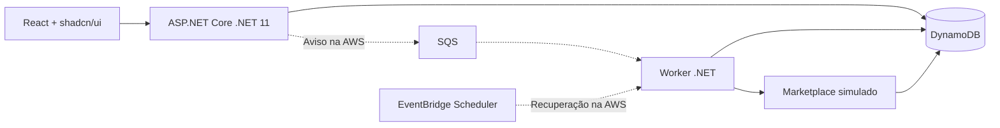

# SyncForge

Painel full stack para comparar o estoque de um ERP com um marketplace simulado, corrigir saldos por SKU e acompanhar o resultado até a confirmação do destino.

[Veja a demonstração em vídeo](docs/demo.webm).

## Executar localmente

Com o Docker Desktop ou Docker Engine em execução, suba o ambiente.

```sh
docker compose up -d --build
```

Abra [o painel](http://127.0.0.1:8080). O Compose inicia o aplicativo e o DynamoDB Local. As sessões e os lotes ficam no volume persistente do Compose. A [especificação OpenAPI](http://127.0.0.1:8080/api/openapi/v1.json) descreve a API.

Para parar o ambiente, execute `docker compose down`.

## Experimentar o fluxo

1. Em **Importações**, baixe o CSV de exemplo. O saldo disponível é a quantidade física menos as reservas. Uma linha com 12 físicas e 5 reservadas resulta em 7 publicáveis.
2. Em **Divergências**, compare o estoque calculado com o saldo observado. Se um SKU estiver sem vínculo, selecione um anúncio fictício e revise a correção antes de enviar.
3. Em **Lotes**, acompanhe a aplicação por SKU. Abra o histórico para ver as tentativas e a ação disponível.

Para explorar falhas, abra **Carregar cenário misto** na visão geral. O lote tem três casos. Um anúncio sincroniza normalmente, outro é atualizado apesar da resposta perdida e o terceiro fica em conflito porque o saldo mudou. O histórico identifica o resultado de cada um.

## Arquitetura



O [registro de decisões](docs/arquitetura.md) descreve a consistência do lote, as confirmações e a diferença entre execução local e AWS. O [roteiro de publicação](infra/README.md) descreve o empacotamento e os critérios de custo da demo pública.

## Verificar

Com a aplicação em execução, rode a verificação HTTP com Node.js 24.

```sh
node scripts/smoke-flow.mjs
node scripts/smoke-flow.mjs --mixed
```

Para desenvolver e testar, use o SDK .NET definido em `global.json`.

```sh
dotnet test SyncForge.slnx --configuration Release
npm --prefix frontend ci
npm --prefix frontend run lint
npm --prefix frontend run build
npm --prefix frontend exec -- playwright install chromium
npm --prefix frontend run test:e2e
```

Ative `SYNCFORGE_E2E_REAL=1` para incluir os cenários de navegador que usam o ambiente Compose. O CI executa esses cenários junto dos testes com respostas simuladas.

## Licenças de terceiros

[Componentes shadcn/ui](docs/licencas/shadcn-ui.txt) · [Fonte Geist](docs/licencas/geist.txt)
